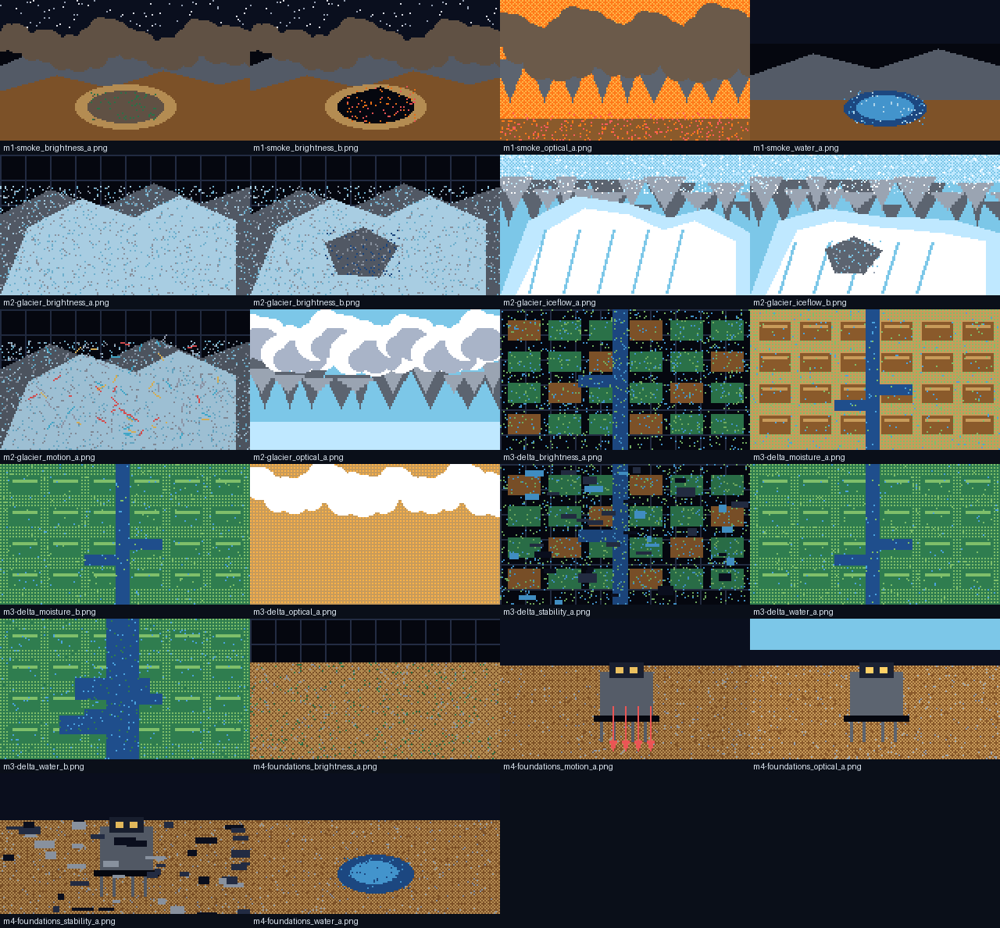

# SARrealists

**SARrealists** is an interactive Earth-observation project built around NASA–ISRO **NISAR** SAR data. It combines a Mapbox-powered scrollytelling landing page, regional NISAR data-analysis pages, a story-driven pixel-art game, predictive concept dashboards, and **LUMEN**, a grounded NISAR assistant.

The project is built with **Next.js 16**, **React 19**, **TypeScript**, **Tailwind CSS**, **Mapbox GL**, **Recharts**, and **Vitest**.

---

## Contents

- [What is included](#what-is-included)
- [Routes](#routes)
- [Quick start](#quick-start)
- [Environment variables](#environment-variables)
- [NISAR data and analysis](#nisar-data-and-analysis)
- [Captain DIO game](#captain-dio-game)
- [LUMEN AI assistant](#lumen-ai-assistant)
- [NISAR processing pipeline](#nisar-processing-pipeline)
- [Repository layout](#repository-layout)
- [Development commands](#development-commands)
- [Testing and validation](#testing-and-validation)
- [Deployment](#deployment)
- [Data and content notes](#data-and-content-notes)
- [Credits](#credits)

---

## What is included

### Interactive landing experience

The home page combines a full-screen Mapbox globe with scroll-driven stories for three regions:

- **California** — wildfire scars, smoke, polarization, and Central Valley subsidence
- **Himalayas** — glacier velocity, dual-frequency radar, and GLOF risk
- **Nile Delta** — soil moisture, agriculture, and coastal subsidence

The landing page also includes a **Mission Control Dashboard** overlay for jumping between regions, toggling NISAR layers, and switching HH/HV polarization.

### Regional data analysis

Dedicated pages provide NISAR-focused explanations and visualizations:

- [California data analysis](/data-analysis/california) — wildfire change, HH/HV polarization, and GUNW subsidence
- [Himalayas data analysis](/data-analysis/himalayas) — dual-frequency physics, glacial lakes, and glacier velocity
- [Nile Delta data analysis](/data-analysis/nile) — soil moisture, crop monitoring, and coastal subsidence

These pages use the static NISAR exports committed under `out_web/`. The site currently reads the monthly plot images and catalog products; the Python pipeline can also generate text-free `plots/heatmap_clean/` overlays for map-oriented use.

### Captain DIO pixel-art game

A playable, bilingual story game at **`/game`**. The player joins Captain DIO's crew, chooses two SAR lenses per mission, makes decisions, and uncovers the final Earth reveal. The game includes:

- Four missions and a final mission report
- English and Arabic UI with RTL support
- 22 original 160×90 pixel-art mission images
- Pixel-art charts, sprites, crew portraits, and scenes
- Crew state, injuries, best-report persistence, and a lens codex
- Optional looping space theme music
- Keyboard-accessible controls and reduced-motion support



### LUMEN assistant

Every page includes a floating **Ask LUMEN** assistant. It supports four explanation personas:

- Scientist
- Decision Maker
- Student
- Enthusiast

LUMEN answers in English or Arabic, cites curated NASA/NISAR sources, can use map-click context, and falls back to a local grounded answer when no model provider is configured.

### NISAR preprocessing pipeline

`nisar_pipeline/` is a separate Python pipeline that streams NISAR granules from ASF, computes calibrated radar products, and exports web-ready catalogs, plots, GeoJSON, COGs, and optional tiles/Zarr stacks.

---

## Routes

| Route | Purpose |
| --- | --- |
| `/` | Mapbox scrollytelling landing page and Mission Control Dashboard |
| `/data-analysis` | Regional NISAR analysis hub |
| `/data-analysis/california` | Wildfire, polarization, and subsidence |
| `/data-analysis/himalayas` | Glacier velocity, frequency comparison, and GLOF risk |
| `/data-analysis/nile` | Soil moisture, agriculture, and coastal subsidence |
| `/game` | Captain DIO playable game |
| `/beyond` | Forward-looking NISAR applications and predictive concept cards |
| `/dashboard` | Simple free-roam dashboard placeholder |
| `POST /api/chat` | LUMEN chat endpoint |
| `GET /api/chat` | Provider diagnostics without exposing the API key |

---

## Quick start

### Requirements

- Node.js 20 or newer
- npm
- A Mapbox public token for the landing-page globe
- Optional: an OpenAI-compatible or Gemini API key for LUMEN's model-backed mode

### Install and run

```bash
npm install
cp .env.example .env.local
npm run dev
```

Open [http://localhost:3000](http://localhost:3000).

The site works without a Mapbox token, but the landing map will remain unavailable. The rest of the page, the data-analysis pages, and LUMEN remain usable.

### Production build

```bash
npm run build
npm start
```

---

## Environment variables

Copy `.env.example` to `.env.local` and fill in only the values you need.

```env
# Optional: Mapbox public token for the landing-page globe
NEXT_PUBLIC_MAPBOX_TOKEN=

# LUMEN provider: use either Gemini or an OpenAI-compatible endpoint
GEMINI_API_KEY=
OPENAI_API_KEY=
OPENAI_BASE_URL=
OPENAI_MODEL=gpt-4o-mini

# Optional request timeout in milliseconds
OPENAI_TIMEOUT_MS=90000

# Optional: low, medium, or high for compatible reasoning models
OPENAI_REASONING_EFFORT=
```

Notes:

- `NEXT_PUBLIC_MAPBOX_TOKEN` is public and is used by the browser map.
- `OPENAI_API_KEY` and `GEMINI_API_KEY` are server-only. Do not prefix them with `NEXT_PUBLIC_`.
- If the key starts with `AIza`, the chat route treats it as a Gemini key and uses the Gemini OpenAI-compatible endpoint automatically.
- Without an AI key, LUMEN still answers from the bundled NISAR references and labels the result as a grounded local answer.
- Environment values can be quoted or unquoted; the route strips surrounding quotes.

---

## NISAR data and analysis

### Data layout

The repository contains a web export under `out_web/`:

```text
out_web/
├── california/
│   ├── catalog.json
│   ├── grids/
│   ├── plots/
│   │   ├── monthly/
│   │   └── heatmap_clean/     # generated by the pipeline
│   ├── timeseries/
│   └── vectors/
├── himalaya/
└── nile_delta/
```

Typical products include:

- `catalog.json` — layer metadata, dates, bounds, and asset URLs
- `plots/monthly/` — labeled QA/report figures
- `plots/heatmap_clean/` — text-free, transparent map overlays
- `grids/` — cursor value lookup grids
- `timeseries/` — point time series for charts
- `vectors/` — GeoJSON overlays

### URL configuration

The web data helpers are in:

- `src/lib/nisarData.ts` — jsDelivr URLs for `out_web`
- `src/lib/nisarConfig.ts` — raw GitHub catalog and layer URLs

If you move the data export to another host, update these base URLs.

### Important limitation

The regional pages use illustrative/static exports for the current build. They are not a live operational hazard service, and the NISAR pipeline is a research workflow rather than an official alert system.

---

## Captain DIO game

The game route is `src/app/game/page.tsx`, with the main application in `src/game/GameApp.tsx`.

### Content

Game content lives in `public/game/`:

```text
public/game/
├── story.json       # opening story and crew dialogue
├── lenses.json      # SAR lens library
├── missions.json    # four missions, outcomes, and visuals
├── reveal.json      # final Earth reveal and CTA
├── facts.json       # sourced fact registry
├── img/             # 22 pixel-art mission images
└── audio/           # space theme music
```

The pre-reveal story intentionally avoids real place names, coordinates, and place-specific source URLs. Those belong in `reveal.json`.

### Game commands

```bash
npm run validate:content   # schemas, spoilers, images, sources, and text checks
npm test                   # engine, content, state, and UI tests
npm run typecheck
python3 scripts/generate_game_images.py  # optional: regenerate mission pixel art
```

The generated PNGs are committed, so running the image generator is optional.

### Game source map

- `src/game/types.ts` — domain types
- `src/game/content.ts` — Zod schemas, parsing, localization, accessors
- `src/game/engine.ts` — quality tiers, outcomes, crew state, endings
- `src/game/state.ts` — reducer and best-report persistence
- `src/game/validation.ts` — content validation rules
- `src/game/art/` — palette, sprites, scenes, canvas and sprite components
- `src/game/components/` — dialogue, briefing, lenses, results, decisions, reveal, report
- `src/game/GameApp.tsx` — data loading, lazy reveal, phase routing, persistence
- `src/game/i18n.ts` — English/Arabic strings
- `src/game/game.css` — pixel chrome and RTL layout

More design context:

- [`docs/GAME_PROMPT_V2.md`](docs/GAME_PROMPT_V2.md)
- [`docs/GAME_AUDIT.md`](docs/GAME_AUDIT.md)
- [`docs/ROADMAP.md`](docs/ROADMAP.md)

---

## LUMEN AI assistant

The assistant is mounted globally from `src/app/layout.tsx` through `src/components/ai/AiAssistant.tsx`.

### How it works

1. The chat panel sends a question, persona, language, and optional map context to `POST /api/chat`.
2. The route validates the request and applies a small in-memory rate limit.
3. `src/ai/knowledge.ts` retrieves relevant NISAR/SAR chunks from a curated source set.
4. `src/ai/promptBuilder.ts` builds a grounded prompt with the selected persona.
5. The route calls an OpenAI-compatible provider, or returns a local grounded fallback.
6. Sources, confidence notes, and optional map actions are returned to the UI.

### Relevant files

- `src/app/api/chat/route.ts` — validation, provider selection, rate limit, completion call
- `src/ai/knowledge.ts` — curated NASA/NISAR sources and deterministic retrieval
- `src/ai/personas.ts` — Scientist, Decision Maker, Student, Enthusiast
- `src/ai/promptBuilder.ts` — grounded prompts and language handling
- `src/ai/fallback.ts` — offline grounded answers
- `src/components/ai/ChatPanel.tsx` — floating chat UI
- `src/ai/components/PersonaSwitcher.tsx` — persona selector

### Provider diagnostics

Visit `GET /api/chat` to see whether a provider is configured and which key source/model is being used. The response never returns the API key.

---

## NISAR processing pipeline

The Python pipeline is independent of the Next.js app. It lives in `nisar_pipeline/` and writes the web export consumed by the site.

### Install

```bash
python3 -m venv .venv
source .venv/bin/activate        # Windows: .venv\Scripts\activate
pip install -r nisar_pipeline/requirements.txt
```

The pipeline uses `asf_search>=14.1.0` for current NISAR archive support.

### Build a site export

```bash
python -m nisar_pipeline.run_site build \
  --site nile_delta \
  --products GCOV GUNW SME2 \
  --monthly \
  --out-dir out_web \
  --clean-size 1600
```

### Generate clean map overlays

```bash
python -m nisar_pipeline.run_site clean \
  --site nile_delta \
  --out-dir out_web \
  --clean-size 1600 \
  --force-clean
```

`clean` reads the catalog's COG paths and adds `heatmap_clean_pngs` without reprocessing the scientific products.

### Recover clean overlays from older monthly plots

```bash
python -m nisar_pipeline.run_site clean \
  --site california \
  --out-dir /path/to/old/out_web \
  --from-monthly \
  --clean-size 1600 \
  --force-clean
```

### Faster map-only runs

```bash
python -m nisar_pipeline.run_site build \
  --site nile_delta \
  --products GCOV GUNW SME2 \
  --monthly \
  --out-dir out_web \
  --skip-tiles \
  --skip-zarr \
  --clean-size 1200 \
  --looks 2 \
  --max-dates 12
```

See [`nisar_pipeline/README.md`](nisar_pipeline/README.md) for the full pipeline guide.

---

## Repository layout

```text
.
├── src/
│   ├── app/                 # Next.js routes, layout, chat API
│   ├── components/          # landing, map, dashboard, charts, AI UI
│   ├── game/                # Captain DIO engine, content, art, components
│   ├── ai/                  # knowledge, personas, prompts, fallback
│   ├── lib/                 # NISAR data/config helpers
│   ├── hooks/               # NISAR catalog hook
│   └── types/               # shared NISAR types
├── public/
│   └── game/                # game JSON, images, audio
├── out_web/                 # committed NISAR web export
├── nisar_pipeline/          # Python ASF/NISAR processing pipeline
├── scripts/                 # content validation and pixel-art generation
├── tests/                   # Vitest suite
├── docs/                    # game spec, audit, roadmap, asset preview
├── .env.example
├── next.config.ts
├── package.json
└── README.md
```

---

## Development commands

| Command | Purpose |
| --- | --- |
| `npm run dev` | Start the Next.js development server |
| `npm run build` | Create a production build |
| `npm start` | Run the production server |
| `npm run lint` | Run ESLint |
| `npm run typecheck` | Run strict TypeScript checking |
| `npm test` | Run the Vitest suite once |
| `npm run test:watch` | Run Vitest in watch mode |
| `npm run validate:content` | Validate game JSON, images, sources, and spoilers |

---

## Testing and validation

The repository currently includes tests for:

- Game engine, outcomes, and reducer transitions
- Content schemas, spoilers, image references, and source rules
- Best-report persistence
- Pixel-art palette and sprite integrity
- Accessible game components and a full four-mission playthrough
- LUMEN retrieval, fallback, and chat-panel behavior
- Mapbox failure isolation

Run the full web check with:

```bash
npm run typecheck
npm test
npm run validate:content
npm run build
```

Pipeline tests:

```bash
python -m pytest nisar_pipeline/tests/test_pipeline.py -q
```

---

## Deployment

The app is designed for **Vercel** or any Node.js host that supports Next.js 16.

### Vercel checklist

1. Import the GitHub repository.
2. Add the environment variables from `.env.example`.
3. Set `NEXT_PUBLIC_MAPBOX_TOKEN` if the landing map should be visible.
4. Set either `GEMINI_API_KEY` or `OPENAI_API_KEY` for model-backed LUMEN answers.
5. Deploy.

The chat route declares a 60-second maximum duration. Large NISAR assets are served from the committed `out_web/` export through jsDelivr/raw GitHub URLs, so they are not bundled into the Next.js server function.

---

## Data and content notes

- The game's mission dates, facts, and radar visuals are illustrative placeholders until real NISAR crops and sourced facts are supplied.
- The game validation rules intentionally prevent pre-reveal content from leaking real place names, coordinates, or place-specific source URLs.
- NISAR applications shown here are research and demonstration contexts, not operational safety, evacuation, or disaster-alert products.
- The regional analysis pages are educational visualizations, not a replacement for official NISAR products or scientific review.
- If you replace the data export, update the URLs in `src/lib/nisarData.ts` and `src/lib/nisarConfig.ts`.

---

## Credits

- **NISAR** — NASA/JPL-Caltech and ISRO
- **ASF DAAC** — NISAR archive access
- **NASA Earthdata** — SAR and Earth-observation references
- **Mapbox** — landing-page globe
- **Next.js, React, Tailwind CSS, Recharts, Framer Motion** — web stack
- **Captain DIO pixel art and game content** — original project assets

For questions, issues, or contributions, open an issue or pull request in the repository.
