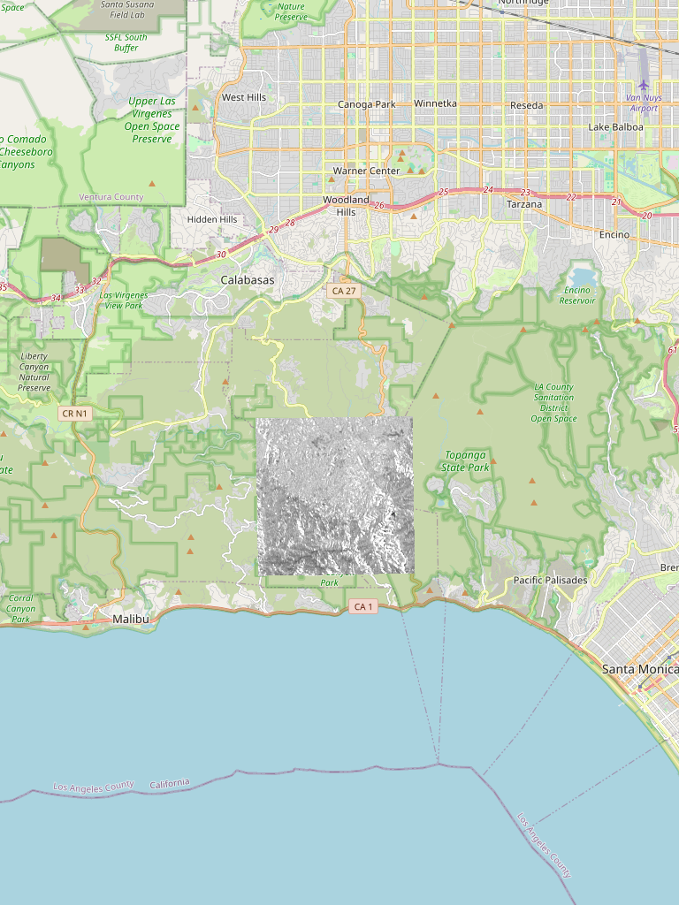
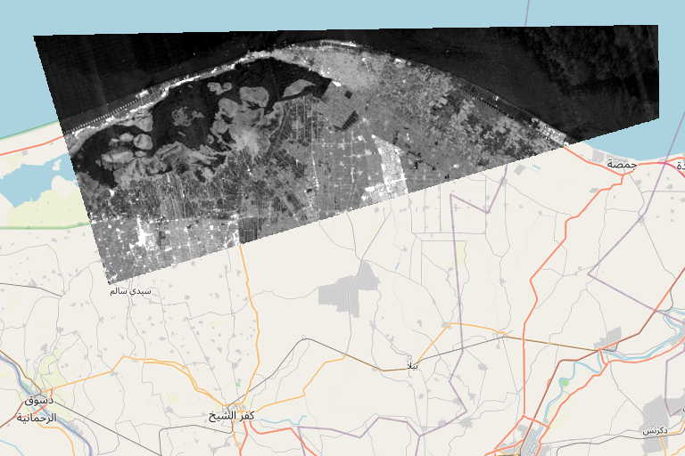
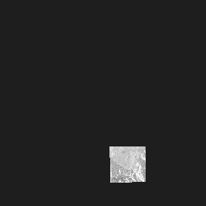

# Web Mercator tiles — findings and corrected pipeline

**Repo:** `Yomnaalaraby/SARrealists` @ `main` (aa182010)
**Date:** 2026-11-14

## Bottom line

I could not run the requested job as written, and I do not think it is the right fix. Three independent problems block it:

1. **There are no COG files in the repo.** `out_web/<site>/cog/` does not exist in either `Yomnaalaraby/SARrealists` or `Mohamadadel510/SARrealists` (0 `.tif`/`.tiff`/`.vrt`/`.nc` files in either git tree). `catalog.json` lists paths like `cog/hh_db/20261026.tif`, but those files were never committed. `gdal2tiles` has nothing to read.
2. **The existing tiles are already in Web Mercator and already land in the right place.** Overlaying them on OpenStreetMap puts the California scene on the Santa Monica Mountains between Malibu and Topanga, and the Nile scene on the northern Delta. If they had been cut from UTM coordinates without reprojection, they would sit near 3°E / 32°N (Egypt/Sahara), not over California.
3. **The "floating rectangle" is a coverage problem, not a projection problem.** California currently has exactly **4 tiles per layer-date** (one at z10, one at z11, two at z12) — a single 256 px square on the map. Himalayas has 38, Nile 68. Nothing exists above z12, and 20 of California's 22 dates, 12 of Himalaya's 13 dates and 11 of Nile's 13 dates have no tiles at all.

## Evidence

### 1. Existing tiles align with the basemap

California `hh_db/20251124` tiles composited over OSM at z12. The scene sits on the Santa Monica Mountains, between Malibu (bottom-left) and Topanga/Pacific Palisades — exactly the AOI in the catalog (`-118.81, 33.97, -118.00, 34.31`).



Nile Delta `hh_db/20251112` over OSM at z10 — the swath is a rotated parallelogram because of the orbit heading, which is normal for a SAR footprint, not a projection error.



Tile-index arithmetic agrees: `12/698/1634` → −118.65°, 34.09° (California), and `10/174/408` → −118.83°, 34.39°. Tile paths only make sense in Web Mercator; UTM-cut tiles would not produce these indices.

### 2. The visual artifact is one tiny tile

The full California z10 mosaic is a single 256×256 square with ~3 % opaque pixels. That is the "floating rectangle": a nearly empty tile island over a zoom-9 basemap.



Current committed coverage:

| Site | Layer-dates present | Tiles each | Zooms |
|---|---|---|---|
| California | 11 (hh, hv, rvi, pol_ratio, 2 changes) | 4 | 10–12 |
| Himalayas | 4 (hh, hv, rvi, pol_ratio) | 38 | 10–12 |
| Nile Delta | 11 | 68–71 | 10–12 |

### 3. The proposed commands fail (tested on GDAL 3.8.4)

```
$ gdal2tiles.py --xyz --tmscompatible --webmercator --zoom=8-18 --resampling=bilinear \
    --srcnodata="0" --profile=mercator input.tif out/
gdal2tiles.py: error: no such option: --webmercator
```

- `--webmercator` does not exist. The mercator profile is selected with `-p mercator` / `--profile=mercator`.
- `--tmscompatible` is only valid with the `raster` profile; combined with `mercator` it is rejected.
- `--xyz` already gives Mapbox XYZ ordering.

The fallback step is worse than useless:

```
gdal_translate -a_srs EPSG:3857 input_utm.tif out.tif
```

`-a_srs` only rewrites the CRS label; it leaves UTM eastings/northings in place. I reproduced it on a synthetic EPSG:32611 raster of the California AOI:

| Step | Upper-left coordinate | Tiles produced |
|---|---|---|
| `gdal_translate -a_srs EPSG:3857` | 332781, 3796982 (read as metres) → **3.0°E, 32.3°N** | `12/2082/1659` — Egypt |
| `gdalwarp -t_srs EPSG:3857` | −13226655, 4070504 → **118.8°W, 34.3°N** | `13/1392/3263` — California |

So the `-a_srs` route would *create* the floating rectangle the ticket describes. Real reprojection needs `gdalwarp -t_srs EPSG:3857`.

## Scale: this cannot go into git

Tile counts for the requested z8–18, using the catalog bounds and the layer/date lists in the ticket:

| Zoom range | Tiles | ≈ size @12 KB/tile |
|---|---|---|
| z8–14 | 1.33 M | ~15 GB |
| z8–16 | 20.5 M | ~234 GB |
| z8–18 | 325 M | ~3.7 TB |

GitHub blocks files over 100 MB, and Git LFS free storage is 1 GB. Even z8–14 is ~150× over the repo budget. Tiles need object storage or a tile server; the COG-plus-titiler route (`/cog/tiles/WebMercatorQuad/{z}/{x}/{y}`) avoids materialising tiles at all.

## What I built instead

`scripts/render_webmercator_tiles.py` — a corrected, tested replacement for the batch script:

- reprojects with `gdalwarp -t_srs EPSG:3857` and verifies the result is EPSG:3857 before tiling;
- uses valid `gdal2tiles` flags (`--xyz --profile=mercator --resampling=bilinear --tiledriver=PNG`);
- caps the maximum zoom from the source ground resolution (`--zoom 8-auto`) instead of blindly generating z18;
- preserves the exact output layout `public/<site>/tiles_<letter>/<layer>/<date>/{z}/{x}/{y}.png`, handles `YYYYMMDD_YYYYMMDD` change layers, skips finished outputs, and warns above 1 GB;
- supports `--layers`, `--dates`, `--processes`, `--force`.

Tested end-to-end on a synthetic EPSG:32611 COG of the California AOI: detected `EPSG:32611 → 3857`, rendered z8–11 (resolution-capped), 37 tiles, first tile at −119.53°, 35.46°.

```bash
python3 scripts/render_webmercator_tiles.py --sites california himalaya nile_delta --zoom 8-auto
```

## Two frontend bugs that will still bite after tiling

In `src/components/map/MapComponent.tsx`:

- Nile RVI builds `/nile_delta/tiles_n/rvi//{z}/{x}/{y}.png` (empty date segment) → 404.
- Himalayas CHANGE always requests `hv_db_change/20251112_20251124` (the Nile range).
- Dates are hardcoded (`20251124`, `20251126`), so newly generated dates will not be reachable.

## To unblock

Send me the COG location (Google Drive folder, Colab runtime path, or bucket). I can then run the script, verify every layer-date against the basemap, and set up hosting outside git — or wire the COGs into titiler so no tiles are stored at all.
